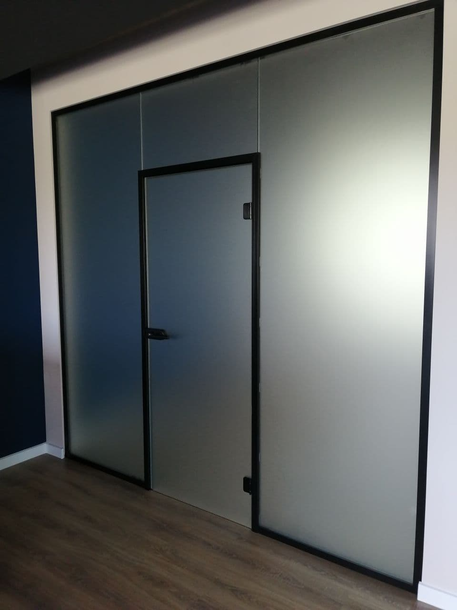

[Алюминиевые перегородки](https://дизайнстекло.рф/peregorodki-iz-stekla/alyuminievye-peregorodki/) – конструкции с каркасом из алюминиевого профиля и светопрозрачным, непрозрачным или комбинированным заполнением. Обычно перегородки занимают пространство от пола до потолка, заменяют стену. Это удобный инструмент зонирования пространства, перепланировки помещения. Наиболее широкое распространение приобрели офисные алюминиевые перегородки, с помощью которых разделяют рабочие места, функциональные зоны. Но востребованы они также в торговых и развлекательных центрах, на вокзалах и в аэропортах, в выставочных павильонах, галереях, в различных административных зданиях, на производстве и в жилых интерьерах.

## Основные элементы алюминиевых перегородок

**Алюминиевые перегородки состоят из таких элементов:**

- профили для сборки каркаса, ширина и конфигурация которых зависит от толщины, материала заполнения;
- заполнение, которое помимо разграничения пространства может выполнять дополнительные функции – звукоизолирующую, теплоизолирующую, декоративную;
- в стационарных моделях – дверные полотна, фурнитура и комплектующие для установки дверей (ручки, замки, петли, уголки, закладные, кронштейны, эксцентрики, доводчики);
- в раздвижных моделях – направляющие и ролики для подвижных панелей;
- в мобильных – опоры, колесики.

## Преимущества алюминиевых перегородок в самаре

Монтаж алюминиевых перегородок не относится к перепланировке, которая требует согласования. Это быстровозводимые конструкции, монтаж перегородки требует меньше времени, усилий и финансовых затрат, чем возведение стены из кирпича, блоков, стеклоблоков. Отсутствуют мокрые процессы, образуется минимум пыли, строительного мусора. В случае необходимости перегородку легко демонтировать без повреждения несущих конструкций, придется лишь заделать или замаскировать декоративными накладками отверстия под крепеж. Если разделение на зоны необходимо лишь в определенные промежутки времени, но не постоянно, можно использовать мобильные перегородки. Помимо удобства и широких функциональных возможностей к достоинствам алюминиевых перегородок относятся:

- высокая жесткость, прочность каркаса;
- небольшая толщина, экономия полезного пространства;
- возможность заполнения различными материалами, создания прозрачных и глухих перегородок, интересных дизайнерских решений;
- возможность сборки перегородок сложной формы, в том числе криволинейных, изогнутых (алюминиевый профиль отличается высокой пластичностью);
- наличие внутри алюминиевого профиля полостей под скрытую прокладку коммуникаций;
- взаимозаменяемость модулей в модульных конструкциях;

[Алюминиевые стеклянные перегородки на заказ в Самаре.](https://xn--80ahegeiiipn3am.xn--p1ai/peregorodki-iz-stekla/)

## Разновидности алюминиевых перегородок

Алюминиевые перегородки по способу монтажа подразделяются на:

- стационарные, элементы каркаса крепятся к полу, потолку, стенам, панели неподвижны. Если не ставится задача полностью разделить помещения, в перегородке делают дверной проем;
- раздвижные, функцию дверей выполняет одна или несколько подвижных панелей. Такие системы удобны в помещениях, где недостаточно места для распахивания дверей;
- мобильные (передвижные), оснащены опорами для надежной установки, иногда с колесиками для удобства перемещения. Состоят из отдельных модулей и могут образовывать конструкции разной конфигурации. В отличие от стационарных и раздвижных, не касаются потолка, их высота не превышает 2 м, а у отдельных моделей (модульных, для разделения рабочих мест) не достигает 1,5 м.

В зависимости от заполнения перегородки из алюминиевого профиля делятся на стеклянные, глухие и комбинированные.

Стеклянные алюминиевые перегородки могут заполняться одинарным или двойным стеклом разной толщины. Иногда вместо стекла используют сотовый поликарбонат. Перегородки со стеклянным заполнением могут быть светопрозрачными, визуально расширять пространство. Если необходимо закрыть, ограничить обзор, используется матовое, тонированное, сатинированное стекло, наносится рисунок, витраж, фотопечать. В случае двойного остекления между стеклами могут вставляться жалюзи для регулировки светопроницаемости. Независимо от светопропускной способности стеклянные перегородки выглядят более легкими и воздушными, чем глухие.

В качестве заполнения глухих перегородок используется ЛДСП, МДФ, гипсокартон, гипсовинил и другие непрозрачные материалы. Глухое заполнение может быть однослойным, двухслойным и с прослойкой теплозвукоизоляционного материала между слоями облицовки (сэндвич-панель). Такие перегородки заменяют стационарные стены.

В комбинированных перегородках часть выполнена из непрозрачного материала, часть – из стекла. Заполнение также может быть одинарным и двойным, с жалюзи между стеклами, улучшенными изоляционными характеристиками глухой части. Наиболее распространенный вариант комбинированных перегородок – конструкции с верхним остеклением. Также изготавливаются перегородки с центральным остеклением (верх и низ глухие) и со сложносоставным (разное расположение глухих и остекленных элементов в разных панелях).

## Цены на алюминиевые перегородки в самаре

На цену алюминиевых перегородок влияют:

- разновидность алюминиевого профиля и металлоемкость конструкции. Так, при изготовлении комбинированных перегородок расход профиля больше;
- материал заполнения, его толщина. Перегородки со стеклянным заполнением дороже комбинированных и глухих, двуслойное заполнение дороже одинарного. Повышают стоимость конструкции использование армированного стекла, установка жалюзи, сэндвич-панелей;
- размеры конструкции, протяженность проема, высота;
- наличие дверей, их материал (стеклянные в алюминиевой раме, с одинарным или двойным остеклением, глухие, комбинированные), механизм открывания (распашные на петлях, маятниковые, раздвижные), количество створок;
- конфигурация конструкции, сложность монтажа;
- затраты на фурнитуру;
- особенности отделки. Декоративное покрытие профиля, использование стекла с тонированием, пескоструйной обработкой, химическим травлением и другими видами декора повышают стоимость конструкции.

  Узнайте цену и сроки Для расчета стоимости нам понадобится любой простейший эскиз (от руки или на компьютере)  
  с кратким описанием задачи либо готовое предложение от наших конкурентов (с ценами или без) Закажите замер Если Вы уже знаете, где и как должны быть установлены перегородки, и у Вас есть примерное понимание цены, рекомендуем сразу вызывать замерщика

Заказать алюминиевые перегородки в Самаре и Тольятти  
Компания ДизайнСтекло использует для монтажа алюминиевых перегородок профили собственного производства и фурнитуру, комплектующие ведущих производителей, осуществляет закалку стекла. Наши специалисты спроектируют под заказ алюминиевые перегородки любой конструкции, размера, осуществят расчет стоимости, изготовят профиль, выполнят раскрой материалов и монтаж. Заказать изготовление перегородок с необходимыми вам характеристиками можно по телефону, электронной почте. Офисы наших представительств есть в Самаре и Тольятти.
