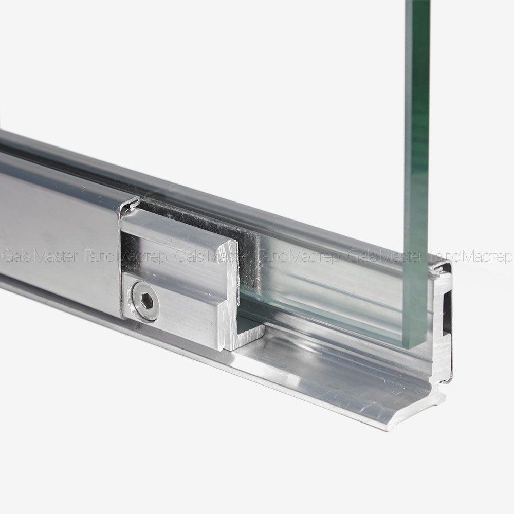
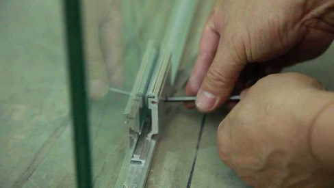

У себя дома можно и собственными «прямыми» руками собрать.

1. Сначала сделайте разметку для будущей перегородки на полу, потолке и стене. А чтобы верхняя и нижняя линии случайно не оказались в разных плоскостях, проверьте их отвесом.  
Монтаж стеклянных перегородок

На рисунке показаны основные элементы зажимного профиля

2. После начитайте установку профиля. Шины прикрутите согласно линиям разметки с помощью дюбель-гвоздей. Под шинами рекомендуется уложить резиновые подкладки. Это отличный шумоизолятор. А еще – своеобразные подушки безопасности для перегородки, если помещение даст усадку.

3. Также с помощью дюбелей прикрутите к шинам одну сторону коннектора — угольники. На каждый метр ширины перегородки установите по 2 таких угольника сверху и снизу. Иначе – перегородка может не выстоять.

4. С помощью винта прикрутите к угольнику вторую часть коннектора – прижим. Но не до конца.  
Крепление стекла в коннекторе

Стекло закручивают в коннекторе шестигранником

5. Следующий этап – крепление стеклянных перегородок. Установите стекло в нижние коннекторы, а затем верхние (и боковые). Отрегулируйте высоту стекла с помощью регулируемых опор, либо подкладок. И зажмите стекло – вкрутите винт в коннектор до упора.

6. Если вы используете несколько стекол, устанавливайте их на расстоянии 1-3 мм друг от друга. А стыки потом заделаете герметиком.

7. В принципе, перегородка готова. Осталось установить декоративные накладки. Они защелкиваются на угольники с одной стороны и на прижимы с другой. На торец профиля, если нужно, прикрутите торцевую крышку.

При заказе большого или супердорогого стекла для офиса мастера сначала устанавливают шины и коннекторы. Затем меряют точное расстояние между ними. А уже после нарезают и привозят вам стекло. Разумно и экономно.
