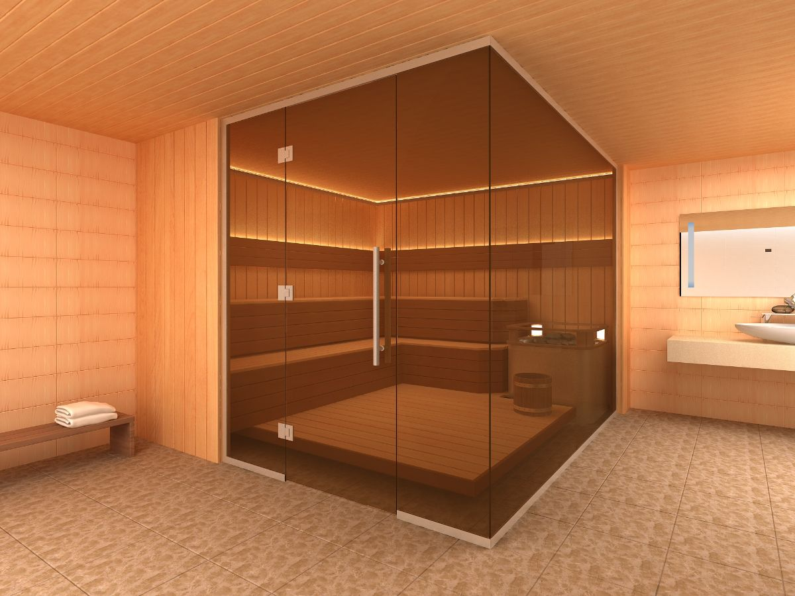

Обустройство [перегородки саун](https://дизайнстекло.рф/peregorodki-iz-stekla/bani-sauny-hamam/) и турецких бань является важным этапом отделки и осуществляется еще на начальном этапе строительства. Ведь единая общая комната в любом построении – это не только неудобно, но и не практично.  
Минимально должно быть представлено два помещения, которые являют собой саму парную и зону для переодевания. При этом перегородки должны в полной мере соответствовать общей дизайнерской концепции.

## Стеклянные перегородки, как наиболее эстетичный вариант

[Перегородки](https://xn--80ahegeiiipn3am.xn--p1ai/peregorodki-iz-stekla/) и [двери из стекла](https://xn--80ahegeiiipn3am.xn--p1ai/dveri-iz-stekla/) ДизанСтекло выглядят модно и относятся к наиболее востребованному материалу. Основными преимуществами стеклянных перегородок выступают:

- Повышенная прочность;
- Износоустойчивость и огнеупорность;
- Высокие звукоизолирующие качества;
- Термостойкость стеклянных перегородок;
- Способность выдерживать широкий разброс температур – от -30 до +50 градусов.

## Стеклянные перегородки для сауны в самаре под заказ

Компания «ДизайнСтекло» предлагает [широкий выбор конструкций](https://xn--80ahegeiiipn3am.xn--p1ai/portfolio/) и дизайна стеклянных перегородок. Преимущественно – это круглые, треугольные, трапециевидные и нестандартные формы. Тип профильной систему позволяет монтировать перегородку как к потолку, так и к полу. При этом представлен широкий выбор цвета стекол – от полностью прозрачного до бронзирующего, матового оттенка. Все в комплексе делает стеклянные перегородки лучшим выбором для обустройства турецких бань и саун.
