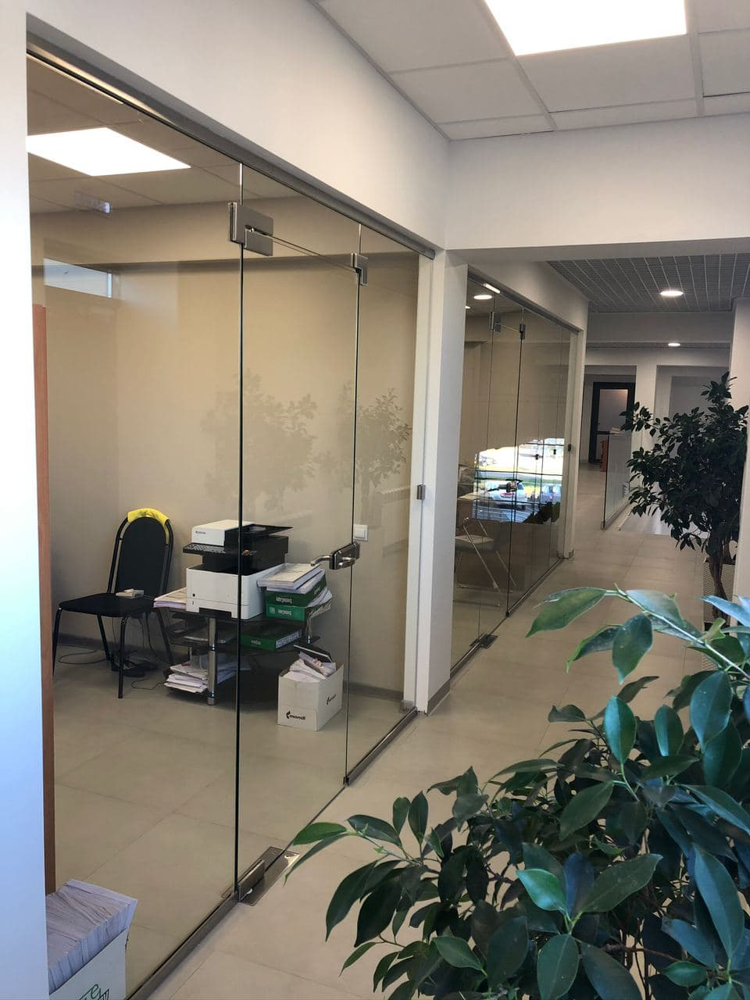
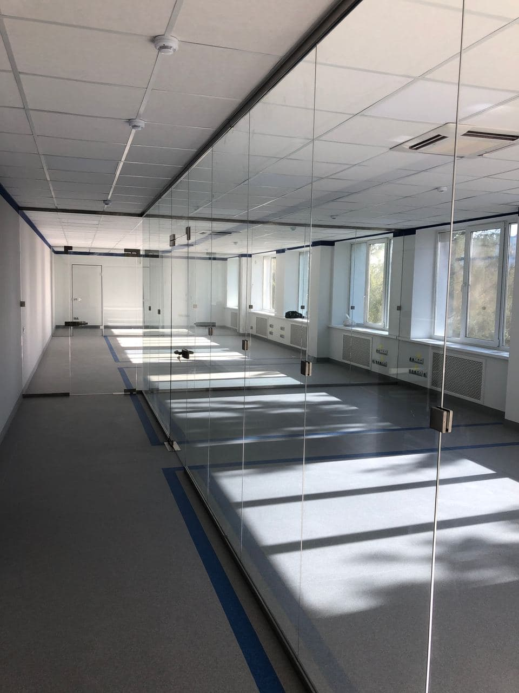

Использование [стеклянных перегородок](https://xn--80ahegeiiipn3am.xn--p1ai/peregorodki-iz-stekla/) для оформления интерьера офисных помещений эффективно решает проблему зонирования пространства, но в то же время помогает сохранить в здании атмосферу открытости и прозрачности. Имея превосходные эстетические качества, перегородки из стекла не лишены и функциональных преимуществ, поэтому они широко востребованы среди дизайнеров, занимающихся проектами оформления офисов по заказу корпоративных фирм.

## Сфера использования перегородок

Стекло имеет универсальную сферу применения, а перегородки из него уместно дополнят конференц-зал, кабинет руководителя, ресепшн, переговорную комнату и административную часть офиса. Они могут быть изготовлены по индивидуальному заказу, поэтому даже в зданиях с нестандартной планировкой, есть возможность достигнуть нужного эффекта – до неузнаваемости преобразить интерьер, чтобы он радовал своей функциональностью и визуальной привлекательностью.

Установка каркасов, на которых закрепляются перегородки, не отнимает много времени, что является немаловажным фактором при необходимости быстрого трансформирования пространства в офисе. Каждый сотрудник на фирме будет обеспечен практичным рабочим местом, а при расширении штата или реорганизации отделов, перегородки могут быть демонтированы и установлены согласно требованиям новой планировки в стенах офиса.  
Если же фирма переезжает в новое здание, то инвестиции, потраченные на установку стеклянных конструкций можно сохранить. Каркас легко демонтируется при необходимости, а затем за несколько часов собирается в новом помещении.

## В чем преимущество стеклянных перегородок?

Существует немало современных материалов, которые также могут использоваться для дизайна интерьера офисных помещений. Но, имея ряд уникальных преимуществ, стекло превосходит их по популярности. В частности, данный материал отличают следующие качества:

- доступная стоимость;
- широкая распространенность;
- простота установки;
- высокий уровень ремонтопригодности;
- отсутствие необходимости согласовывать установку стеклянных конструкций с БТИ;
- возможность изготовления перегородок по индивидуальному эскизу в соответствии с пожеланиями заказчика

Отдельно стоит упомянуть прочность [каркасных перегородок из стекла](https://дизайнстекло.рф/peregorodki-iz-stekla/alyuminievye-peregorodki/). Они лишь на первый взгляд кажутся хрупкими и невесомыми, но на самом деле перегородки рассчитаны на большие нагрузки. Они достойно пройдут испытание временем и сохранят свою функциональность и аккуратный внешний вид.  
Ухаживать за конструкцией также несложно – достаточно периодически протирать стекла специальными моющими средствами для того, чтобы они были блестящими и кристально чистыми. Перегородки устойчивы к механическим повреждениям. Мелкие царапины и сколы им не страшны, поэтому они могут использоваться в офисах с большой проходимостью людей.

## Оформление интерьера кабинета стеклом: сочетание стиля и комфорта

Трендом оформления офисов в Самаре считается использование стекла в кабинете руководителя или начальника отдела. Поскольку перегородка полностью прозрачная, она визуально «растворяет» барьеры между сотрудниками в офисе, делая их взаимоотношения более доверительными, а сотрудничество – продуктивным. Психологи считают, что такой элемент интерьера в офисе способствует улучшению результатов командной работы коллектива.

## Установка дополнительных аксессуаров

При необходимости сохранить конфиденциальность в течение рабочего дня, сотрудники могут закрыть жалюзи или роллеты, установленные на перегородки из стекла. Эти дополнительные аксессуары могут быть изготовлены в различных дизайнах, поэтому выбор цвета и материала для производства роллетови жалюзи подбирается в соответствии с интерьером офиса и пожеланиями заказчика.

## Оценка экологичности и безопасности стеклянных перегородок

По заключениям специалистов, стекло, используемое для изготовления перегородок в офисе, не выделяет вредных токсинов и проявляет пассивное взаимоотношение с химическими реагентами. Это полностью экологичный материал, который без опаски за здоровье людей можно использовать в офисах, где с девяти утра и до шести вечера кипит напряженная работа.
