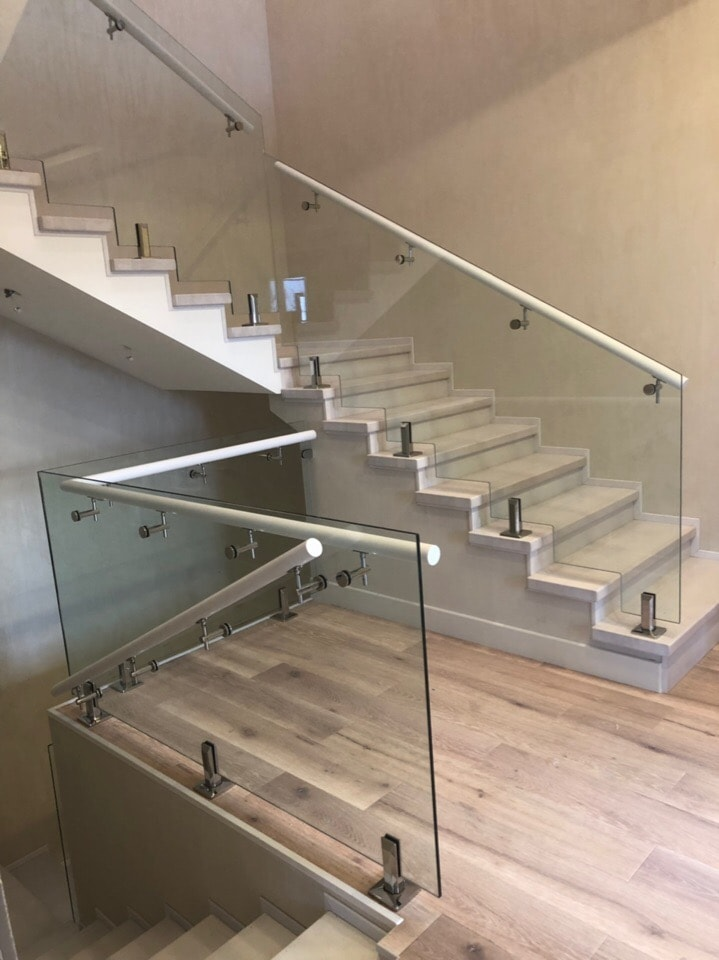
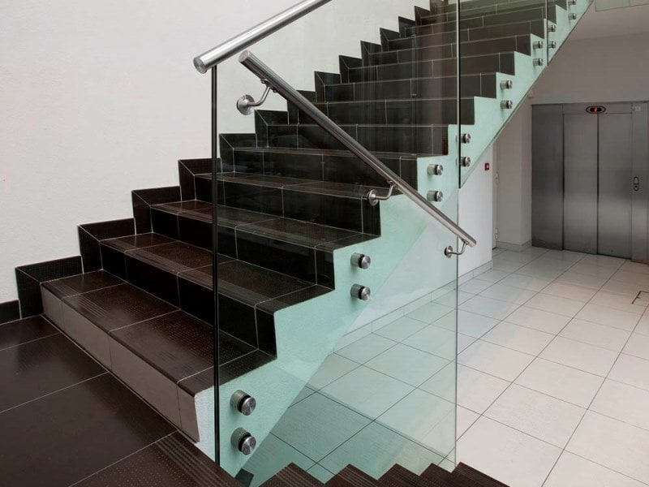
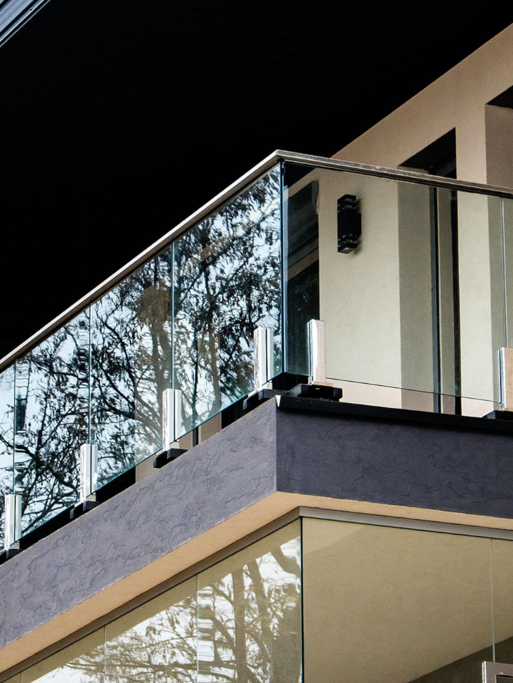
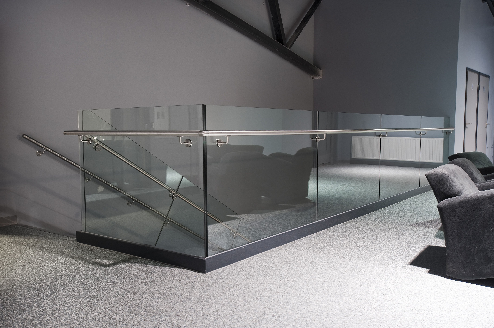
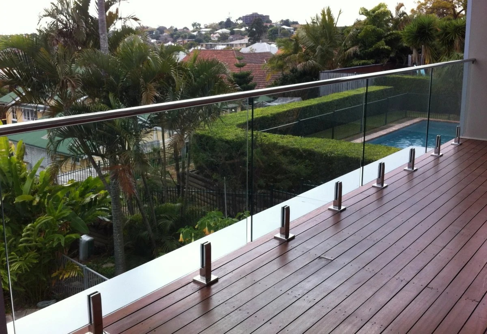

Стеклянные ограждения и балюстрады начали пользоваться активным спросом в течение последних двадцати лет, постепенно вытесняя ограждения, изготовленные из традиционных материалов. Применение стекла в составе ограждений и балюстрад позволяет создавать ограждающие конструкции, объединяющие в себе необходимую функциональность, надежность и безопасность, одновременно сохраняя элегантный современный внешний вид. Использование прозрачного стекла наделяет такие ограждения уникальным свойством визуально открывать пространство, обеспечивая свободный обзор интерьера здания или окружающей панорамы. В частности, по этой причине стеклянные ограждения стали популярны в оформлении торгово-развлекательных комплексов. Такое решение позволяет реализовать концепцию визуально открытого пространства, предоставляя возможность видеть магазины и бутики с разных точек и ракурсов.

Стекло удачно сочетается с деревом, металлом и другими современными конструкционными и отделочными материалами. Это позволяет создавать ограждения, способные украсить интерьеры и здания различных архитектурных стилей и назначений, будь то деревянная лестница или терраса коттеджа, атриум торгового центра или лестница в стиле «hi-tech» в модном автосалоне. Для обеспечения надежности эксплуатации стеклянных оградений допустимо использование исключительно безопасного ударопрочного закаленного и/или ламинированного стекла. Такие виды стекла толщиной 8-12 мм используются в каркасных ограждениях либо ограждениях на стойках в качестве заполняющего материала. В данных типах конструкций аварийное разрушение стеклянного элемента не приводит к потере прочности всего ограждения или его части.

Тенденцией последних десяти лет стало развитие нового типа ограждающих конструкций – самонесущих стеклянных ограждений. Поскольку в таких системах стекло выполняет функции не только заполняющего материала, но и единственного несущего элемента конструкции, к нему предъявляются особые требования по прочности и безопасности. Таким материалом является специальное многослойное ламинированное стекло толщиной от 20 до 40 мм, состоящее из большего чем в обычном “триплексе” количества слоев закаленного стекла (минимум 3-х) и высокопрочной полимерной пленки. Особая прочность и надежность закалённого ламинированного стекла позволяет таким ограждениям выдерживать серьезные нагрузки в процессе эксплуатации. Если такое стекло подвергнется экстримальному аварийному воздействию, благодаря своей многослойности, оно будет разрушено только частично. Слои стекла и пленки, сохранившие целостность, обеспечат устойчивость и безопасность ограждающей конструкции до замены поврежденного элемена, а также не позволят осколкам стекла высыпаться удерживая их на эластичной пленке.

Для стеклянных ограждений и балюстрад компания “ДизайнСтекло” использует сертифицированное закаленное и ламинированное стекло собственного производства. Мы предлагаем стеклянные панели различных цветов, степени прозрачности и структуры поверхности. Для внесения разнообразия и эксклюзивности наша компания предлагает множество технологий и вариантов декорирования стеклянных полотен и нанесения на них рисунков и логотипов:

- накладные элементы;
- декоративное ламинирование;
- триплекс с внутренним битым каленым стеклом “колотый лед”;
- художественное матирование;
- фотореалистичная печать.

Современные технологии и оборудование расширяют границы для воплощения дизайнерских идей и позволяют изготавливать стеклянные ограждения самой различной формы и сложности.

Поручни являются значимым функциональным элементом стеклянных ограждений, также выполняющим и важную декоративную роль. Они могут применяться при любом типе ограждающих конструкций и изготавливаются из различных материалов:

– натурального дерева;  
– стекла;  
– черного металла;  
– полированной нержавеющей стали;  
– шлифованной нержавеющей стали;  
– алюминия.

При подборе материала и конструктива поручней для стеклянного ограждения специалисты компании “ДизайнСтекло” принимают во внимание тип архитектурного объекта и место установки ограждения. Учитываются критерии безопасности, устойчивости к перепадам температур и другим погодным факторам, износостойкость, удобство эксплуатации и обслуживания.

Форма поручней в разрезе может быть различной: металлическая труба круглой или прямоугольной формы, п-образный или другой тип профиля. Компания “ДизайнСтекло” также предлагает разнообразные деревянные и кованные варианты поручней на заказ. В самонесущих конструкциях распространен вариант выполнения стеклянного ограждения без поручня.

## Архитекторы рекомендуют применять стеклянные ограждения:

— для ограждения крыльца;  
— на террасах кафе и ресторанов;  
— в атриумах торгово-развлекательных центров;  
— для ограждения лестничных маршей и площадок;  
— на балконах и мансардах частных домов, коттеджей, пентхаусов;  
— для ограждения автострад и магистралей;  
— для ограждения смотровых площадок;  
— на верандах и террасах частных домов;  
— для ограждения платформ на станциях метро;  
— ограждения площадок на крышах зданий;  
— для ограждения мостовых пешеходных переходов;  
— для ограждения бассейнов.  
Возможные места применения стеклянных ограждающих конструкций торговой марки “ДизайнСтекло” не исчерпываются данным перечнем.

## Функциональные возможности стеклянных ограждений:

 

- Обеспечение безопасности в местах перепада высоты;
- Защита от ветра, пыли, песка;
- Шумозащита (звукоизоляционная функция);
- Защита от падения в воду детей и животных.

## Преимущества стеклянных ограждений ДизайнСтекло:

- стильный и современный внешний облик;й
- визуально не загромождают пространство, обеспечивая свободный обзор;
- высокий уровень надежности благодаря использованию безопасного закаленного или ламинированного стекла;
- устойчивость к воздействию агрессивных факторов окружающей среды;
- длительный срок эксплуатации с сохранением первоначального внешнего вида и функциональных качеств;
- легкость в уходе, стекло – водонепроницаемый и не гигроскопичный материал;
- широкий выбор различных видов стекла для изготовления ограждений;
- возможность использования как для интерьерных, так и для экстерьерных решений.

С учетом пожеланий заказчика, специалисты компании “ДизайнСтекло” готовы реализовать практически весь спектр существующих видов стеклянных ограждений как по типу конструктива, так и архитектурного дизайна.
