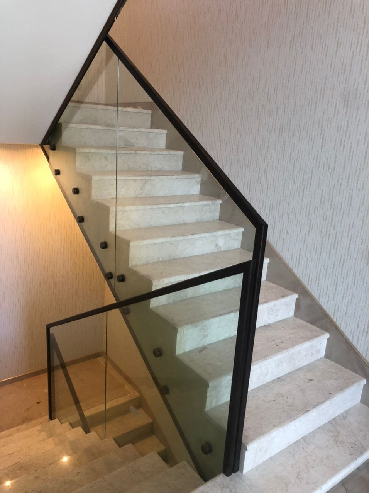
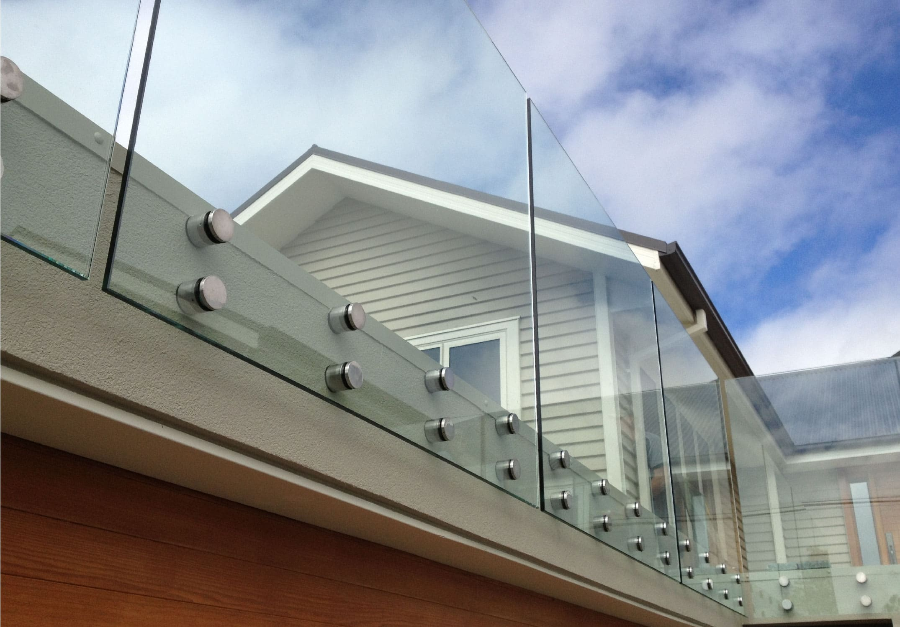

Стеклянные детали интерьера всегда смотрятся выигрышно. Они не только зрительно расширяют пространство, но и придают помещению современный и оригинальный вид. Особенно популярны сегодня стеклянные ограждения для лестниц и балконов.

Достоинство [стеклянных ограждений](https://xn--80ahegeiiipn3am.xn--p1ai/orgrazhdeniya-iz-stekla/) состоит в том, что их можно монтировать как внутри помещений, так и снаружи. В случае внутреннего использования стекло чаще всего применяется в декоративных целях, например, на лестницах. На открытом же воздухе из данного материала делают ограничители балюстрад, террас, балконов и т.д.  
Преимущества использования стеклянных лестничных перегородок очевидны:

- надежность;
- безопасность;
- необычный внешний вид;
- отсутствие громоздких профилей.

## Разновидности моделей для лестниц

В современной архитектуре используются несколько типов стеклянных перегородок, устанавливаемых на лестничных клетках:

- [стоечное;](https://дизайнстекло.рф/orgrazhdeniya-iz-stekla/ograzhdenie-lestnic-na-stojkax/)
- со скрытым крепежом;
- [с точечным креплением.](https://дизайнстекло.рф/orgrazhdeniya-iz-stekla/ograzhdenie-lestnic-na-tochkax/)  
  При этом каждый из вариантов имеет собственные преимущества.

## Стоечное ограждение

Такой тип можно назвать классическим. Из стекла в этом случае делается только заградительное полотно, стойки же остаются металлическими или деревянными. Благодаря такому сочетанию становится возможным объединить традиционный и современный подходы.

## Ограждение со скрытым крепежом

Помогает создать иллюзию того, что стекло присоединяется прямо к лестнице. На самом же деле, крепления из металла просто надежно спрятаны от посторонних глаз с помощью декоративных элементов. Фиксация ограждения с торца лестницы смотрится очень эффектно: кажется, что вся конструкция просто парит в воздухе.

## Модели с точечным креплением

Универсальный вариант, который подойдёт также для атриумов и террас. Благодаря металлическим креплениям, которые располагаются с торца, между стеклом и лестницей остаётся свободное пространство. Это удобно во время уборки: пыль не будет скапливаться в узком проеме, ее можно легко убрать с помощью обычной тряпки. Еще одно достоинство такого варианта — возможность сохранить площадь балкона или террасы без изменений. Так получается, поскольку крепление проводится с внешней стороны.

Любой из перечисленных типов ограждений для лестниц выполняется в модификации с перилами или без.

## Стеклянные перегородки на балконе

Балконные ограждения из стекла все чаще можно увидеть в современных квартирах. Они имеют следующие преимущества:

- полная безопасность;
- возможность сохранить презентабельный фасад дома;
- стильный внешний облик;
- высокие теплоизоляционные свойства.

Последнее свойство крайне важно в условиях зимы, когда на лоджии особенно холодно. А в сочетании с шумонепроницаемыми характеристиками подобное стекло станет настоящим подарком для всех ценителей комфорта.

Компания «ДизайнСтекло» предлагает большой ассортимент стеклянных ограждений разного назначения. Все они сделаны из материала высочайшего качества и будут служить вам долго. Также ограждения из стекла могут украсить любой дом и зрительно расширяют жилое пространство. Остается лишь подобрать тот вариант, что вам понравится!
