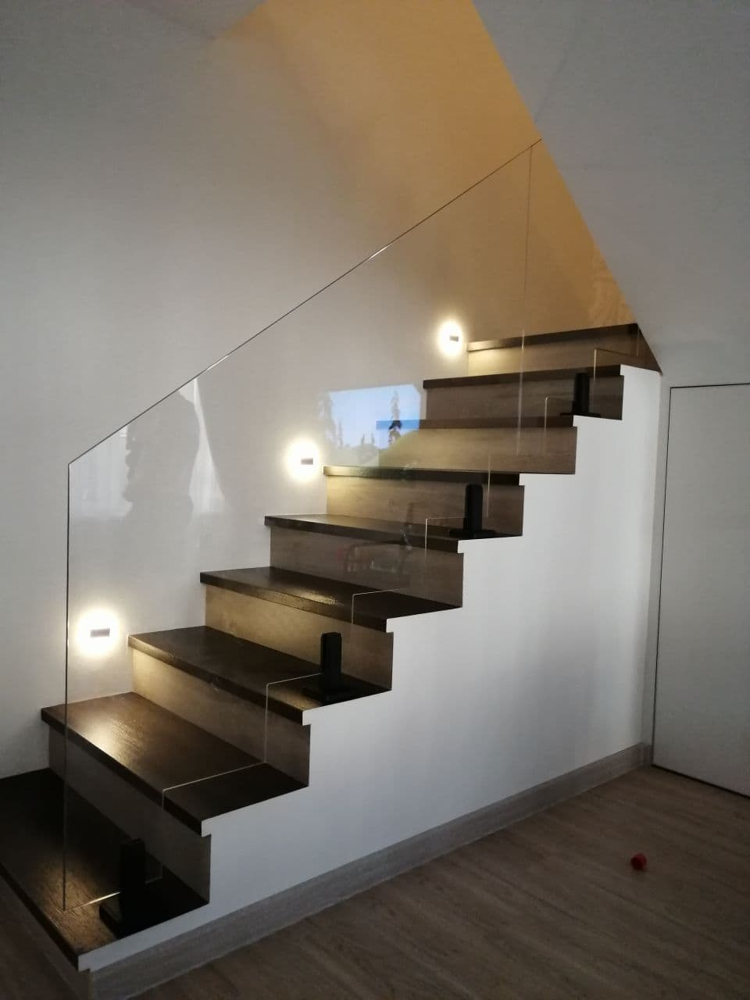
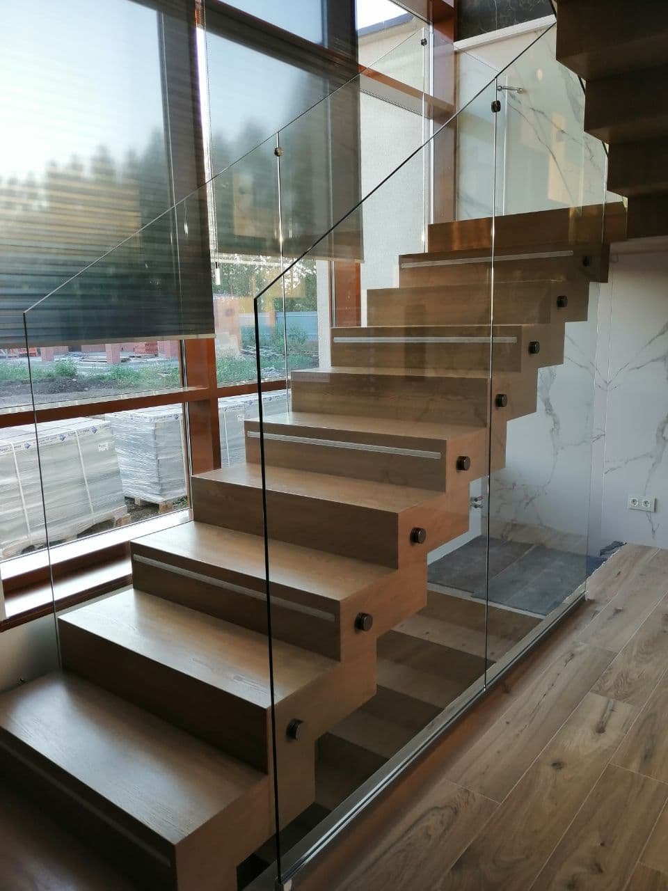
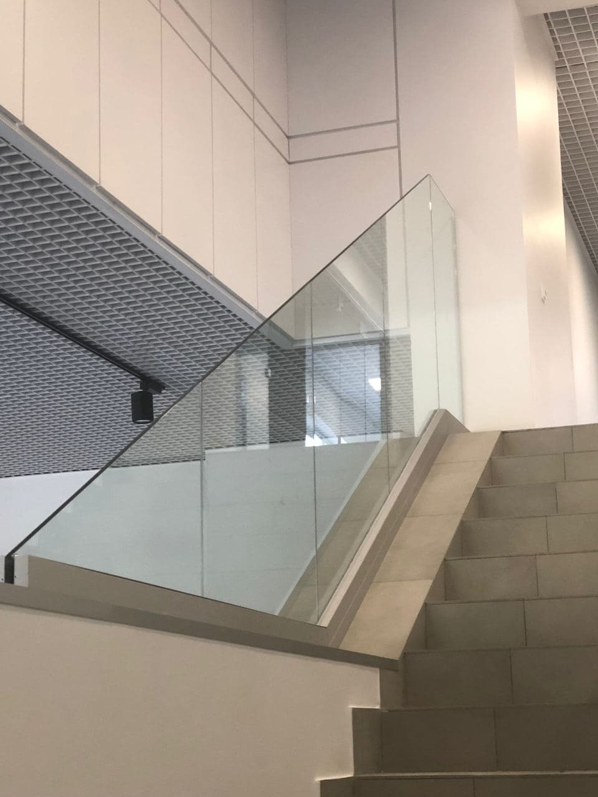

Стеклянные, прозрачные и невесомые ограждения, которые не акцентируют на себе излишнего внимания, отлично подходят к различным интерьерам, создают эффект прозрачности и увеличивают пространство. Благодаря своей универсальности, этот тип ограждений может быть использован в жилых домах, деловых центрах, торговых комплексах. Стекло позволяет воплощать смелые дизайнерские фантазии и придавать интерьеру и экстерьеру интересные акценты. Различные виды обработки, такие как моллирование, нанесение рисунка при помощи пескоструйной обработки, тонирование стекла разными цветами позволяют делать ограждение интересным объектом интерьера.Несмотря на свою кажущуюся хрупкость, стекло, применяемое для ограждений, прочно, не подвержено неблагоприятному воздействию окружающей среды и при элементарном уходе конструкция сохраняет привлекательный внешний вид даже дольше, чем металлические ограждения.

Согласно техническим требованиям по ГОСТу высота ограждения, вне зависимости от назначения, должна составлять не менее 900 мм. Толщина стекла может варьировать в пределах от 6 до 18 мм.

## Типы конструкций стеклянных ограждений

**Стеклянное ограждение с балясинами из нержавеющей стали (Тип 1)**

Несущие стойки на всю высоту ограждения с креплением к поручню, стеклянные панели устанавливаются между стойками, с креплением к ним же. Вариантов исполнения несущих стоек существует более 200 (стойки могут быть цельными из нержавеющей стали, а так же из нерж.стали со вставками из закаленного цветного стекла либо натурального дерева). Полный ассортимент [представлен в Каталоге](https://xn--80ahegeiiipn3am.xn--p1ai/orgrazhdeniya-iz-stekla/).

**Цельностеклянное ограждение на стойках (Тип 2)**  
Стеклянные панели на всю длину ограждения с креплением к несущим мини-стойкам в нижнем секторе. Поручень в данном варианте крепится непосредственно на стекло.

**Цельностеклянное ограждение на точках(Тип 3)**  
Стеклянные панели фиксируются точечными держателями к существующим конструкциям в помещении (например, к торцу перекрытия или лестничного марша). Поручень крепится непосредственно на стекло.

**Цельностеклянное ограждение с фиксацией в зажимном профиле снизу (Тип 4)**

Стеклянные панели на всю длину ограждения фиксируются зажимным профилем снизу. Зажимной профиль может быть видимым (установлен на чистый пол), либо скрытым внутри настила пола (в этом варианте зажимной профиль не виден, а линия остекления начинается непосредственно от пола – достигается наибольший эффект ажурности конструкции). Поручень крепится непосредственно на стекло.

**Очевидные преимущества стеклянных ограждений:**

- исключительная прочность
- полная безопасность
- возможность придать стеклу любую форму и цвет
- варианты обработки поверхности пескоструем или моллированием.

На стеклянные ограждения цена, конечно, не самая низкая, но это, пожалуй, самый эффектный способ оформить объект в частном или многоквартирном доме. Параллельно можно подумать о том, чтобы лестница, по которой вы поднимаетесь, также была необычной и стильной и заказать ограждение лестницы из стекла. Стойки для стеклянных ограждений зачастую делаются из алюминия или стали. Ограждение из стекла и цена его – предмет договора, заключаемого нами с каждым заказчиком. В нем мы подробно оговариваем все пожелания и требования. Для частных коттеджей мы предлагаем стеклянное ограждение террас или бассейна. Все материалы, используемые в процессе остекления, имеют необходимые сертификаты, а множество вариантов оформления стеклянного ограждения не оставят вас равнодушными.

**Уровень надежности стеклянных ограждений**  
Даже стеклянные ограждения без стоек обладают фурнитурой, рассчитанной на то, чтобы стеклянная конструкция, кроме визуальной воздушности и легкости, на деле обладала незыблемой прочностью, ведь от этого могут зависеть человеческие жизни. Поэтому необходимы также и квалифицированные и точные расчеты специалистов, что напрямую влияет на безопасность наших клиентов. Солидный опыт в сфере продажи стеклянных систем позволяет нам в полной мере гарантировать Вашу безопасность, учитывая все виды нагрузок, приходящиеся на стеклянное ограждение.

**Как заказать [стеклянные ограждения](https://xn--80ahegeiiipn3am.xn--p1ai/orgrazhdeniya-iz-stekla/) в Самаре?**  
Заказать стеклянное ограждение очень легко — оставьте заявку на сайте или по телефону. Также можно посетить наш офис. Индивидуальный заказ не только возможен, но и приветствуется! Мы сможем вписать ограждение из стекла в любой интерьер, гармонично использовать натуральное дерево, металл, камень или их комбинацию. Самые лучшие и стильные образцы выполненных нами работ представлены в разделе «[портфолио](https://xn--80ahegeiiipn3am.xn--p1ai/services/ograzhdeniya-iz-stekla/)». Заказав стеклянные ограждения балконов, лестниц или бассейна – вы получите не только стильные и воздушные, но функциональные, надежные, легкие в уходе и долговечные предметы интерьера, которые сегодня есть не у каждого. Они смогут свидетельствовать не только о вашем изысканном вкусе, но и об определенном статусе.
