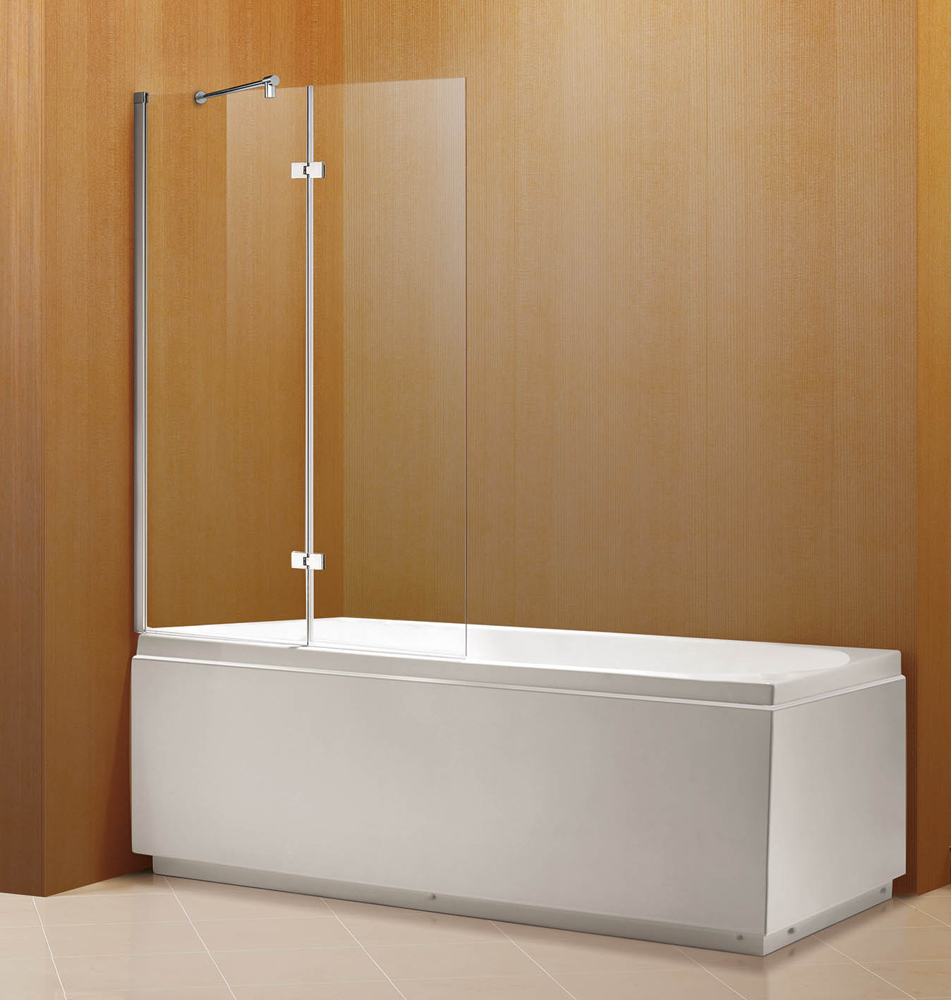

Стекло широко применяется в современных интерьерах ввиду практичности, экологической безопасности и привлекательного внешнего вида. Одним из вариантов использования стеклянного материала в интерьере является установка шторки в ванную комнату. Конструкцию можно декорировать, подобрать нужную по размеру, толщине и способу монтажа. Все это нужно учесть перед выбором подходящего варианта, а также правильно осуществить установку.  
**Виды, особенности стеклянных шторок для ванной**

Для производства изделий подобного типа используют специальное закаленное стекло, которое подвергают воздействию высоких температур. Оно не боится ударов из-за прочности, поэтому его часто применяют при обустройстве офисных помещений, квартир и частных домов. Даже при разбитии закаленное стекло не сможет причинить травму: осколки имеют округлые края, о которые невозможно пораниться.

Стеклянная шторка в ванную служит отличным решением, поскольку на ней не образуется грибок, а уход не доставит хлопот.

Существует несколько видов конструкций, которые отличаются внешним оформлением:

- прозрачные;
- тонированные – сверху нанесена специальная затемняющая пленка;
- с рисунком – созданные пескоструем или принт;
- матовые – стеклянная шторка подвергается обработке.

**По способу открывания системы бывают:**

- Монолитные, фиксированные – больше похожи на перегородку. Устанавливаются от бортика ванны до потолка, иногда – до уровня душа. Легко монтируются и снимаются.
- Распашные – требуют много места для открытия, поэтому нецелесообразно устанавливать такие стеклянные шторки в маленьких ванных комнатах. Важно правильно подобрать ручки: они должны быть удобными и подходить к интерьеру помещения.
- Раздвижные – удобные в использовании. Подходят для зонирования, компактны, не занимают свободное место ванной.
- Складные – состоят из стеклянных панелей. В закрытом виде занимают минимум места. Подходят для комнат и ванных любой формы и размера.

Выбор той или иной шторки из стекла в душевую или ванную комнату обусловлен размером и дизайном помещения. Важно учесть расположение туалета, душевой кабины, ванной, мебели.

Стеклянные шторки могут быть на каркасе или без него. Каркас в свою очередь бывает пластиковый и металлический. Чаще предпочитают установить именно такие каркасные модели в ванную комнату из-за большей устойчивости.  
**Как установить: главные правила и нюансы работы**

Монтаж в каждом конкретном случае будет разниться, что объясняется выбором конструкции стеклянной шторы в ванную. Основная разница состоит в числе мест крепежа: конструкции могут крепиться одновременно к двум стенам или только к одной.

Чтобы установить шторку для ванной или душевой правильно и качественно, нужны соответствующие инструменты и опыт выполнения подобных работ. Нужно учитывать, что владелец будет иметь дело с закаленным стеклом, а крепить конструкцию к стене, покрытой плиткой. Это означает, что отверткой обойтись не получится. Работы нуждаются в щепетильности и аккуратности проведения. Чуть сильнее придавить на дрель – и плитка треснет.

**Для монтажа стеклянной шторки в ванную потребуется:**

- дрель;
- шуруповерт;
- рулетка;
- лазерный уровень;
- силиконовый герметик.

Установить стеклянную шторку в ванную или душевую нужно, соблюдая порядок выполнения работ:

- Шторка поставляется в разобранном виде, если она состоит из нескольких частей. Ее собирают на объекте, непосредственно перед установкой.
- Проблем не возникнет, так как производители прилагают в комплект инструкцию.
- Определяем места крепления. Для этого используем рулетку, уровень и маркер, которым отмечаем, где будут располагаться отверстия. Важно, чтобы вода, которая попадет на стеклянную шторку, свободно стекала в ванную, а не на пол. Для этого конструкцию выравнивают.
- С помощью дрели проделываются отверстия, устанавливается каркас. По линии соприкосновения каркаса со стеной и ванной наносится силиконовый влагостойкий герметик. Это изолирует область ванной или душевой от пространства комнаты.
- По прошествии двух часов со времени нанесения герметика, можно установить стеклянную шторку.
- После монтажа силиконом важно обработать стык между стеклом и каркасом. Конструкцию не трогать несколько часов до полного высыхания герметика.
- Дверцу или дополнительные элементы системы монтируют на ванную или в душевую кабину в самом конце, как завершающий этап сборки.

Стеклянная шторка в ванную комнату – изделие со внушительным весом. Монтировать его в одиночку будет затруднительно, поэтому понадобится помощь подсобника.

Если не уверены в силах, никогда не имели дела со стеклянными конструкция и шторками в ванную или душевую кабину, в частности, обратитесь к профессиональным монтажникам. Мастера сделают работу качественно, без риска разбить или повредить стеклянное изделие.
