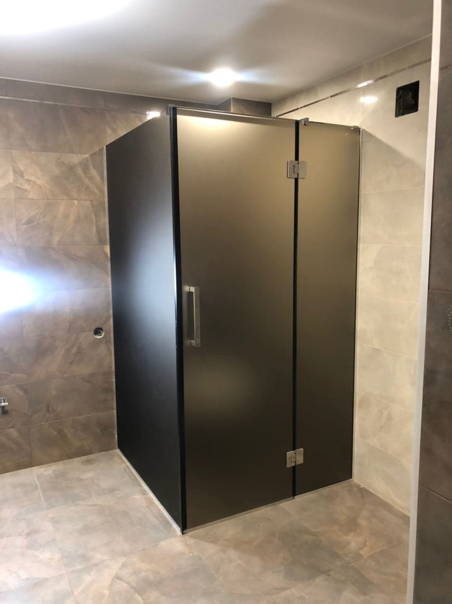
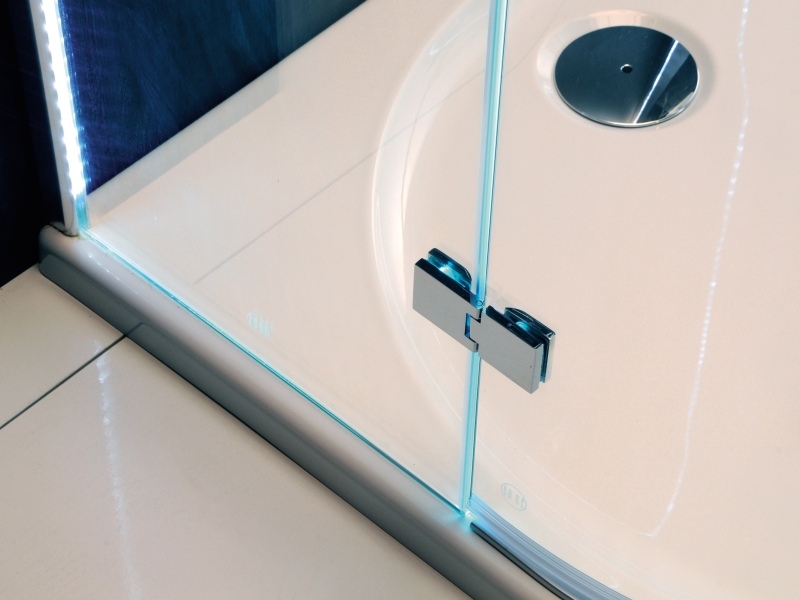
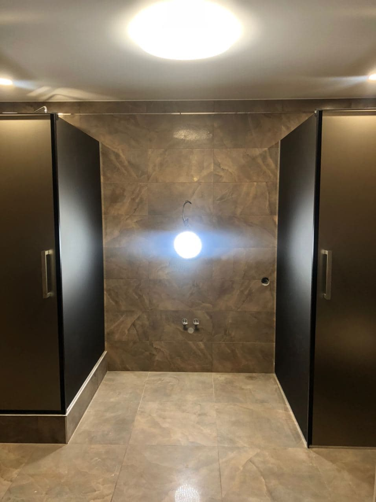
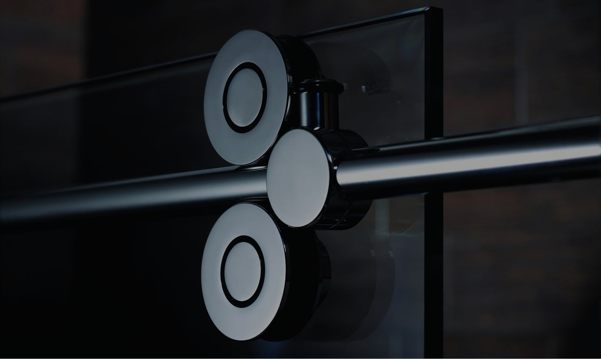
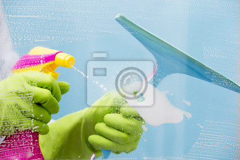

[Душевые кабины](https://дизайнстекло.рф/dushevye-iz-stekla/) изначально предпочтительней ванны. Это обусловлено их компактностью и возможной многофункциональностью: гидромассажер, радио, телефон и прочие приятные дополнения. В последнее время стали популярны душевые кабины из стекла на заказ. Среди технических характеристик такой кабины есть несколько весомых преимуществ.

Внешний вид

Стекло, из которого состоят стенки кабины, может быть абсолютно прозрачным, затемненным, рельефным либо иметь пескоструйный рисунок. Форма стен может быть самой разнообразной — и это тоже плюс. Такая душевая кабина имеет свойство прекрасно сочетаться с любым дизайном ванной комнаты.

Гидроизоляция

Стенки душевой кабины можно монтировать к поддону, к полу ванной комнаты и даже к бортику ванны. Если стенки устанавливаются непосредственно к поверхности пола, необходимо воспользоваться специальными прозрачными профилями. Они предназначены для того, чтобы обеспечить полную гидроизоляцию душевой кабины. Если стена крепится к бортику ванны, это предотвращает попадание воды за пределы ванны.

Экономия места

Стандартные ванные располагают небольшим пространством, поэтому выбор душевой кабины — оптимальное решение. К тому у стеклянных душевых кабин есть возможность установки раздвижных дверей. Это максимально освобождает пространство для других нужд — например, для стиральной машины.

Фурнитура

Внутри кабины предусмотрены поручни. Это связано с обеспечением безопасности. Все ручки и поручни выполняются из нержавеющей стали. Такая фурнитура для душевых кабин прослужит не одно десятилетие.

Гигиеническая уборка

Стекло — неприхотливый материал. С его поверхности можно с легкостью убрать любую грязь. Для этого всего лишь необходимо чистящее средство для стекол, не содержащее спирта. Трудности могут возникнуть с застарелыми пятнами, но этого не случится, если соблюдать ежедневную уборку после каждого использования душа.
