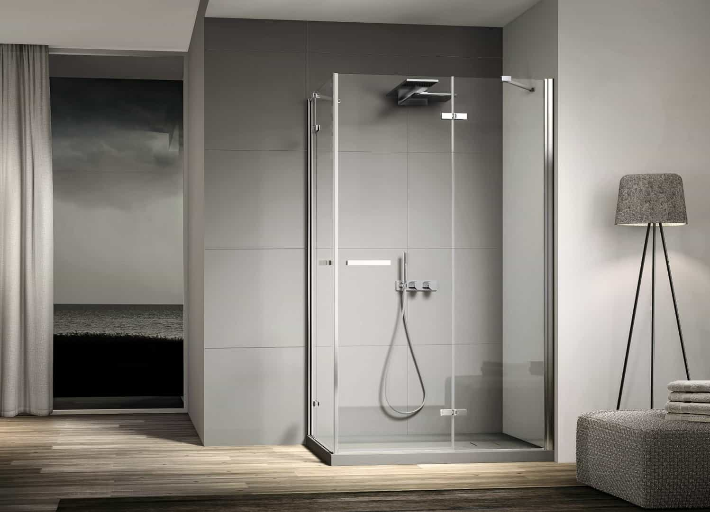

Активный ритм современного человека предпочитает комфорт и минимализм в бытовой жизни. Именно поэтому душевой уголок предпочтительней, чем ванная.

Ведь с таким полезным приобретением, как стеклянные душевые кабины вы не затрачиваете много времени на водные процедуры, экономите воду и сохраняете простор санузла.

## Какие плюсы и минусы готовой душевой и душкабины на заказ?

Решившись купить душевую кабину, вам важно определится: купить сразу готовую конструкцию или заказать индивидуальный проект?

Чаще всего стеклянные конструкции выбираются, учитывая три важных характеристики:

- дизайн;
- качество;
- функциональности душевой кабины.

Если же у вас возникают трудности с выбором готовой душевой кабины: вы знаете, что хотите, но не можете найти; или совсем запутались, что именно вам хотелось бы видеть в своем санузле – тогда идеальным вариантом будет сделать душевую индивидуальным заказом.  
Какой вариант лучше: готовая душевая кабина либо по индивидуальному проекту?

|  |  |  |
| --- | --- | --- |
| Параметры | Стеклянная кабина для душа | |
| Готовый вариант | На заказ |
| Цена | Стоимость товара зависит от выбранного материала: при заказе душевой по специальному проекту у вас есть выбор и материала, и дизайна. А в готовом варианте желаемые материалы и дизайн не совпадают | |
| Сроки изготовления | Доставка готовой душевой на протяжении нескольких дней | 10-12 дней на изготовления по индивидуальному проекту, с учетом размеров конструкции |
| Размерные характеристики | Из-за стандартных размеров при установке остаются большие щели и зазоры. Часто готовая душевая кабина не подходит по размерах в подготовленную нишу. | Изготовление душевой кабины по индивидуальных параметрах, которая идеально впишется в помещение |
| Высота | Стандартные параметры высоты от 180-210 сантиметров. | Можно заказать стеклянную конструкцию любой высоты |
| Материал стенок и дверей | Стенки и двери изготавливаются из двух видов материала: пластик либо закаленное стекло. Каркасный (бескаркасный) способы крепления ограждения | Схожие материалы, что и для готовой душевой. Отличия: отсутствия ограничений на размеры ограждений |
| Количество функций | От самых простых моделей до более обустроенных | Можно установить любые функции по надобности и избежать ненужных |
| Дизайн и цветовая палитра | Чаще всего – белый цвет. Модели подороже выглядят более презентабельно | Разнообразность декоративного украшения стекла, форм и цвета |
| Акции, скидки | Сниженная стоимость на товар | Распродажи и скидки на материалы и фурнитуру |

Суммируем результаты: [душевые кабины на заказ в Тольятти](https://xn--80ahegeiiipn3am.xn--p1ai/dushevye-iz-stekla/) – воплощение в жизнь ваших смелых решений, а также рациональное использование площади ванной комнаты.

Независимо от того: будете покупать готовый вариант или на заказ, – сохраняйте всю техническую документацию душевой кабины. Она может вам пригодится. А для того, чтобы не разочароваться в конечном результате очень внимательно выбирайте фирму для осуществления заказа.

## Где заказать душевой бокс в самаре?

И так вы решили, что душевая кабина под заказ – это отменная идея для вас. Какие шаги предпринимать дальше? Обращайтесь к нам!

Компания ДизайнСтекло изготавливает стеклянные душевые кабины по индивидуальному и эксклюзивному дизайну в Тольятти.  
Не всегда среди предложенных готовых вариантов душевых кабин получается найти именно то, что хочется.

Для того, чтобы заказать душевые кабины из стекла или для более подробной информации: оставляйте заявку на обратную связь на нашем сайте или звоните по номерам телефонов из раздела «Контакты».

Специалист обсудит с вами все технические вопросы и проконсультируют по всем возникшим у вас вопросам.  
Довольный клиент  — успешность любой компании!
