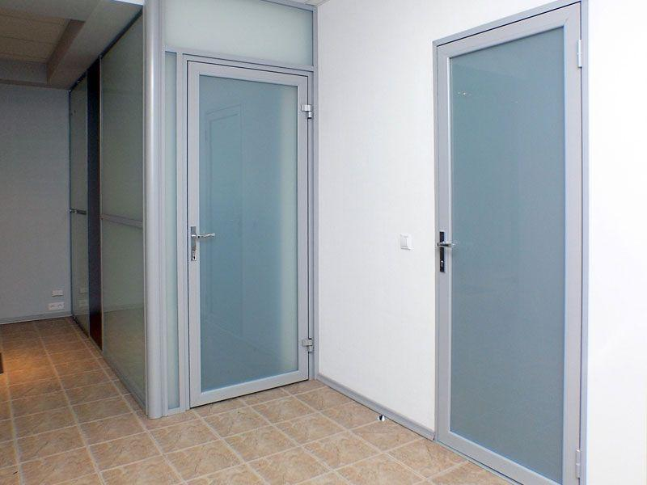
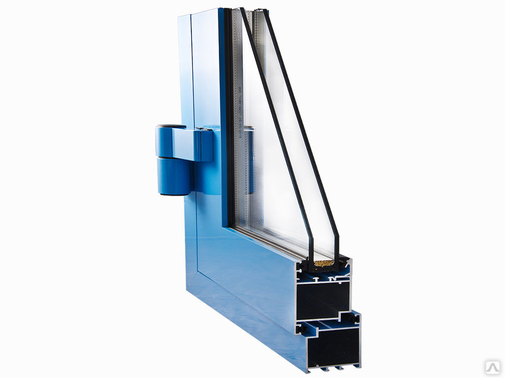
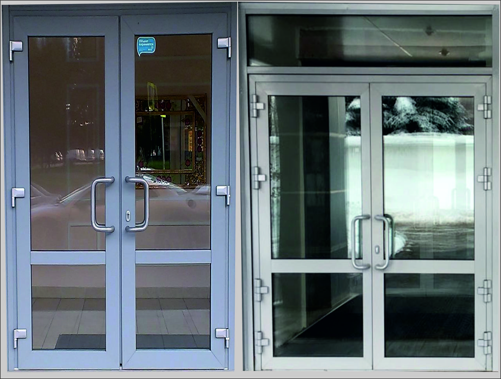

– Алюминиевые распашные двери  
– Алюминиевые раздвижные двери

## Идеальное ультрасовременное решение благодаря непревзойденным свойствам!

Алюминиевые двери выгодно отличаются надежностью и долговечностью, а также широкими возможностями для дизайнеров. В сегодняшнее время алюминиевые двери очень широко используются в коттеджном и офисном строительстве, а также устанавливаются в общественных зданиях.

**Алюминиевые двери** (Тольятти) изготавливаются с использованием системы холодных алюминиевых профилей и системы теплых алюминиевых профилей. Отличительным свойством теплых алюминиевых систем является наличие термомоста (полиамидная термовставка, армированная стекловолокном). Основным назначением (терморазрыв – еще один используемый термин) является теплоизоляция. Достигается это путем запрессовывания полиамидных полос в наружную и внутреннюю части оконного профиля. Максимальное снижение теплопроводности происходит благодаря использованию многокамерного термомоста. Для этой же цели служит элемент из пенополиуретана, располагающийся внутри профиля. Иногда в полиамидных термомостах применяются специальные волокна из легкоплавкого материала, которые при нагревании увеличиваются в размерах и повышают прочность профиля на сдвиг в продольном направлении. Изготовление (производство) алюминиевых дверей – это сложный технологический процесс.  
**Алюминиевые двери** с использованием холодного профиля чаще всего устанавливаются внутри помещений. В то время, как теплые алюминиевые двери, с учетом их высокой степени теплозащиты, используются во внешних дверных проемах (входные дверные конструкции или помещения, в которых должен поддерживаться определенные температурный режим).

**Компания ДизайнСтекло предлагает двери, тамбурные системы с терморазрывом, с традиционным открыванием, маятниковые (открывающиеся в обе стороны), раздвижные автоматические.**  
Двери из алюминиевого профиля способны выдержать большую нагрузку. Они обеспечивают такие технические характеристики, как высокую тепло- и звукоизоляцию, герметичность, технологичность эксплуатации, долговечность. Высокие прочностные характеристики обеспечиваются использованием фурнитуры фирмы SOBINCO и DORMA, поэтому взлом дверей становится практически невозможным. Основное применение алюминиевых дверей – установка в проемы, организованные в теплых помещениях, зимние сады, витражи.

## Теплые алюминиевые двери

Это изолированная трехкамерная система для дверных и оконных конструкций. Без сомнения, эта система – лидер в своем классе и отличается оптимальным сочетанием высоких термоизоляционных свойств и безопасности. Система также предлагает профили разнообразных форм, отвечающих различным архитектурным стилям, пригодные для изготовления любых типов как открываемых наружу, так и внутрь окон и дверей. Представлены четыре различных стилевых решения: функциональное, “Ренессанс”, со скругленными кромками “Softline”, либо со скрытой створкой.

Профили состоят из двух трубчатых алюминиевых половин, которые механически соединяются поставщиком систем в трехкамерные профили с помощью двух сплошных изоляционных полос. Система позволяет использовать разные цвета для внутренних и внешних сторон профилей.  
Результаты термического имитационного моделирования, примерно к системе, колеблются между следующими значениями: 2.0 < KR < 2.8 Вт/м2 К (значения класса 2.1 согласно DIN 4108 IV).  
Строительная высота теплоизолированных алюминиевых профилей внешней коробки – 59 мм, а профилей створки – 68 мм. Строительная высота закрепленных коробок и импостов может быть увеличена в зависимости от оказываемой ветровой нагрузки и моментов инерции профилей. Ширина профилей створки определяется размерами открывающихся частей. Номинальная толщина структурных стенок профиля – от 1.6 до 1.8 мм. Стенки профиля также образуют внутреннюю камеру, в которой устанавливаются обжимные угловые элементы, а также внутренние и внешние фальцы.

Высота фальца профилей и раскладок для остекления – 25 мм. Фальцы меньшей высота отсутствуют. Полость для остекленения – не более 47 мм (остекление до 36 мм). Штапики вставляются прямо в профили без применения синтетических деталей.  
Профили отвечают нормам EURONUT, что позволяет устанавливать практически все аксессуары европейских типов, в которых имеются стандартные профильные пазы.  
Чтобы добиться достаточной водонепроницаемости в нижней части окон, все профили коробок и импосты имеют пониженный водоотвод. Разница между дренажным уровнем и верхом внутренней половины профиля – 7.5 мм.  
Соединительные профили (угловые профили, соединительные профили между различными типами окон) имеют продольные выемки для предварительного отформованных круглых резиновых уплотнителей. Эти уплотнители обеспечивают прекрасную ветро- и водонепроницаемость винтовых профильных соединений без использования силиконов.  
**Возможные ограничения:**  
– Максимальные ограничения по стеклопакетам 2000 x 3000 мм  
– Максимальная высота конструкции, не требующая установки дополнительного усиливающего профиля 3000 мм  
– Макс. высота конструкции с дополнительным усиливающим профилем 7000 мм  
– Рекомендуемые размеры оконной створки 1200 x 1700 мм  
– Макс. ширина дверной створки до 1200 мм  
Используемый стеклопакет до 40 мм.

## “Холодная” оконно-дверная система

В данной системе используются “холодные” алюминиевые профили (без терморазрыва), имеющие конструктивную глубину 45 мм. Применяются для изготовления внутренних оконно-дверных конструкций, входных групп и перегородок. В качестве заполнения используется стекло, алюминиевые или ПВХ сэндвич, алюминиевая вагонка; по желанию заказчика возможна установка стеклопакета. Базовый цвет конструкций белый – RAL 9010. По желанию заказчика возможно изготовление конструкций любого цвета (по шкале RAL).

**Данная система используется для изготовления следующих типов конструкций:**

– глухое остекление  
– поворотное окно  
– поворотно-откидное окно  
– фрамуга  
– распашная дверь

По желанию заказчика в конструкциях входных групп и дверей могут применяться фигурные ручки и доводчики.  
Согласно термической классификации по нормам DIN, данная система относится к группе № 3 (тепловой коэффициент КR составляет свыше 4.5 Вт/м2 К).  
Возможна установка систем автоматического открывания дверей.

**Возможные ограничения:**

– Максимальные ограничения по стеклопакетам 1600 x 2300 мм  
– Максимальные ограничения по стеклу 2000 x 3000 мм  
– Макс. высота конструкций, не требующая установки дополнительного усиливающего профиля 2700 мм  
– Макс. высота конструкций с дополнительным усиливающим профилем 3500 мм  
– Макс. размер оконной створки (ширина x высота) 1200 x1700 мм  
– Макс. ширина дверной створки до 1200 м  
– Используемый стеклопакет (4-8-4 или 4-10-4) 16 и 18 мм  
– Нет возможности изготовления штульпового окна  
– Нет возможности изготовления арочных конструкций
