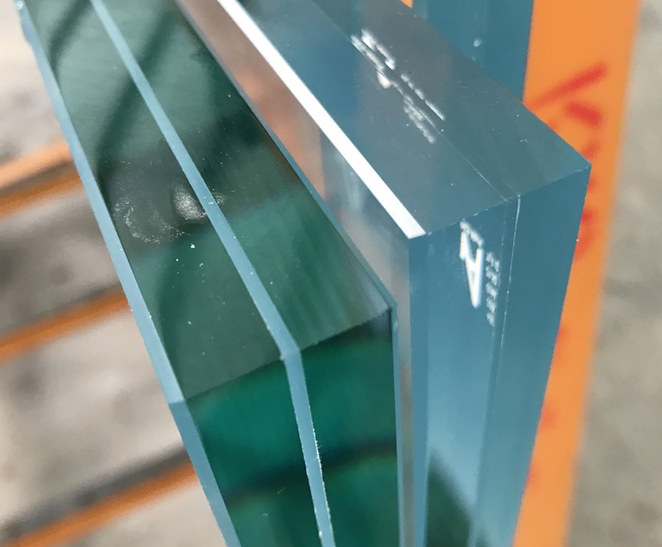

Триплекс (многослойное стекло, ламинированное стекло) **–**один из видов безопасного стекла. Триплекс состоит из 2 и более стекол, которые склеены с помощью этиленвинилацетатной (EVA) пленки или полимерной композиции.

Отличительной особенностью триплекса является то, что при разрушении стекло держится на прослойке, создавая характерную паутину. Именно прослойка предотвращает повреждение осколками при разрушении. Такой материал используют в тех случаях, где есть высокий риск разбиения стекла (фасадное остекление, автомобилестроение).

### Технология изготовления триплекса:

- Лист стекла устанавливают на платформу с резиновыми держателями.
- Поверхность проходит предварительную подготовку: очищается, обезжиривается.
- Стекло укладывается в пакеты из EVA-пленки и откачивается воздух для предупреждения образования воздушных включений.
- Дальше в специальном автоклаве проходит сам процесс триплексования: нагрев до нужной температуры под прессом. Пленка при этом сплавляется и, таким образом, происходит склеивание стекол между собой.
- Обработка торцов по периметру: шлифовка и полировка.

Процесс изготовления триплекса составляет 4-5 часов. Максимальные размеры листа триплекса- 3050 х 2050 мм, минимальные – 50х50 мм. Максимальная доступная толщина – 32 мм, а количество слоев EVA-пленки может достигать 4. Возможно изготовление гнутого триплекса с закаленным стеклом. В этом случае толщина клеящего слоя (пленки) не может быть менее 0,76 мм. Толщина стекла для триплексования – 4-19 мм.

## Триплекс пленочный

Пленочный триплекс изготавливается с использованием EVA-пленки (этиленвенилацетата). Толщина пленки составляет 0,38 мм. Стандартная формула для изготовления триплекса S1+0,38 мм+S2, где S1, S2- стекло определенной толщины. Минимальная толщина триплекса – 5 мм (2х1х2).

### Виды пленки для изготовления триплекса:

- бесцветная;
- матовая;
- цветная;
- декоративная

Кроме пленки могут быть использованы декоративные наполнители из бумаги, ткани, фольги. При использовании стекла с уф-печатью (фотопечатью) или покраской по таблице RAL также лучше использовать данную технологию. Это даст следующие преимущества в сравнении с использованием заливного триплекса: меньший срок на изготовление и ниже стоимость работ.

### Свойства пленочного триплекса:

- стекло после разрушения остается висеть на пленке, предупреждая получение травм;
- может использоваться в качестве безопасного декоративного материала;
- снижение шума от 32 до 45Дб.

Пленочный триплекс имеет небольшую матовость. Уровень пропускания света будет зависеть от общей толщины, марки стекла. В среднем он понижается на 3-5%. Пленочный триплекс уступает в прочности заливному.

### При комбинации различного рода составляющих триплекса, будь то стекла или пленки, можно получить следующие его виды:

1. ударопрочный;
2. многослойный;
3. цветной;
4. прозрачный;
5. матовый;
6. моллированный.

### Область применения:

- остекление зданий;
- [перегородки](https://xn--80ahegeiiipn3am.xn--p1ai/services/peregorodki-iz-stekla/);
- витрины;
- [стеклянные двери](https://xn--80ahegeiiipn3am.xn--p1ai/services/dveri-iz-stekla/) и [стеклянные перегородки](https://xn--80ahegeiiipn3am.xn--p1ai/services/peregorodki-iz-stekla/ "Стеклянные перегородки");
- стеклянные полы;
- [лестничные ступени и ограждения](https://xn--80ahegeiiipn3am.xn--p1ai/services/ograzhdeniya-iz-stekla/);
- [столешницы, столы, стойки и другая мебель из стекла](https://xn--80ahegeiiipn3am.xn--p1ai/services/steklo-v-interere/);
- [полки;](https://xn--80ahegeiiipn3am.xn--p1ai/services/steklo-v-interere/)
- аквариумы;
- стеклопакеты;
- изготовление картин и других элементов декора.
