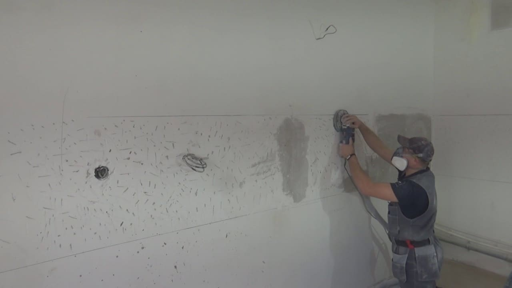
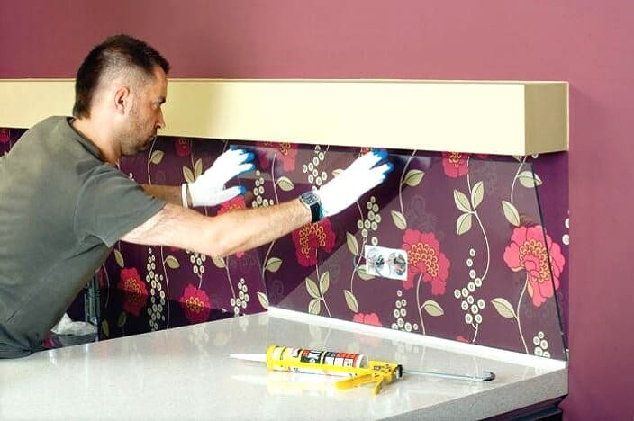

## Кухонный фартук из стекла – стильный и практичный элемент обстановки

Чтобы сделать более эстетичной ту часть стены, которая расположена между рабочей поверхностью гарнитура и навесными шкафчиками, создается декоративный фартук. Он выполняет и практичные функции: защищает стену от горячего пара и влаги, брызг раскаленного масла. Наряду с традиционной керамической плиткой в последнее время пользуются большой популярностью варианты из закаленного стекла. Характеристики материала полностью соответствуют требованиям, предъявляемым к данному элементу кухонной обстановки:

- Способность выдерживать высокие температуры в зоне варочной поверхности;
- Экологическая безопасность;
- Гладкая непористая поверхность, что препятствует накоплению загрязнений;
- Простая очистка с помощью бытовой химии для стекла;
- Эстетичный внешний вид и практически безграничные возможности для дизайна.

В нашей компании в каталоге [стеклянный фартук](https://дизайнстекло.рф/interer/kuxonnye-fartuki/) для кухни на любой вкус. Это могут быть как однотонные глянцевые либо матовые поверхности, так и варианты с рисунками, орнаментами или фотопечатью. Установить такой элемент отделки можно без помощи специалистов – процесс монтажа совсем несложный.

## Как правильно подготовить стены для укладки фартука на кухне?

Стена в месте установки должна быть ровной, сухой и без заметных повреждений. Если недавно был проведен полный ремонт кухни, заботиться не о чем. А когда решается вопрос замены фартука, тогда необходимо выполнить подготовительные работы. Они подразумевают удаление старой плитки или прочих отделочных материалов, оставшихся саморезов или гвоздей, заделывание штукатуркой трещин, сколов и выемок. Затем стена частично выравнивается шпаклевкой. В конце наносится слой штукатурки с помощью маленького шпателя. Когда штукатурка начинает схватываться, поверхность нужно разровнять широким шпателем. Добившись ожидаемого результата, стену нужно оставить на один день до полного высыхания.

## Установка стеклянного фартука самостоятельно: три способа

**Осуществлять монтаж можно тремя способами:**

- Прямое приклеивание;
- Установка на каркас;
- Крепление с помощью саморезов с декоративными заглушками.

Прямое приклеивание подходит не всегда – если стекло очень прозрачное, могут быть видны клеевые швы. Во всех остальных случаях приклеивание – самый простой вариант монтажа. Для этого нужно нанести клей несколькими бугорками на отдельные участки стены. Затем стекло надо поднести к стене, и, слегка надавливая, прижать его к клеевым «маячкам». Для более удобного поднятия можно задействовать ручки-присоски.

Установка на каркас подходит для конструкций с подсветкой или если стены выровнены не идеально. Каркас состоит из деревянных реек или металлического профиля. К такому основанию можно прикрепить стеклянное полотно, как посредством клея, так и с помощью крепежных деталей.  
Крепление напрямую к стене саморезами требует предварительного создания отверстий в стене и стеклянной поверхности. Если предполагается этот способ, произведение отверстий в фартуке заранее должна сделать компания-изготовитель по указанию заказчика. Подготовленное полотно прикладывают к стене и в отверстия вкручиваются крепежи. Шляпки саморезов маскируются заглушками, подобранными в тон изделия.  
Конструкция инсталлирована, не забывайте выполнять должный уход.
