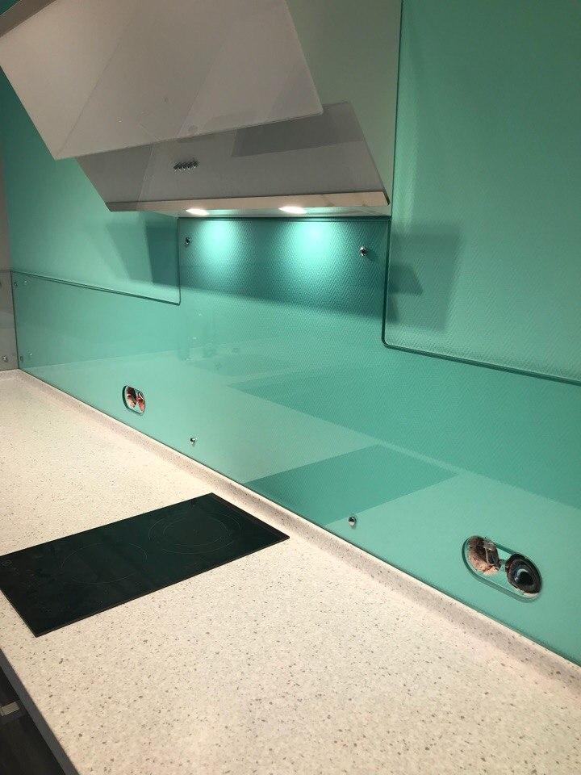

В основе любого из направлений прогрессивного развития общества лежит неудержимое стремление человека совершенствовать окружающее его пространство, в том числе доводя до идеала используемые предметы, улучшая и совершенствуя технологии их изготовления.

Одной из основных тенденций внедрения современных технологий в области оборудования пространства помещений кухни является панель скинали – [кухонный фартук из стекла](https://дизайнстекло.рф/interer/kuxonnye-fartuki/) с возможностью нанесения на него фотопечати.

Ранее используемые технологии предлагали заполнение пространства над поверхностью кухонной мебели (кухонного фартука) отделочными материалами: на основе устойчивых к истиранию красок; керамической плиткой; панелью из материалов, используемых при производстве кухонной мебели.

Некоторые из вариантов выглядели недостаточно практично, другие не совсем эстетично, третьи с трудом вписывались в общий дизайнерский интерьер помещения.

Обобщение всех существующих преимуществ и недостатков каждого из используемых видов отделки позволило прийти к созданию и внедрению идеи производства кухонного фартука из прочного, красивого, устойчивого к внешнему воздействию и истиранию вида стекла с возможностью нанесения на него любого из видов фотопечати по желанию заказчика.

Так появилась панель скинали – лучшая из идей отделки поверхности кухонной стены над рабочей зоной. Широкий спектр дизайнерских решений в области рисунка поверхности помогает скинали гармонично вписаться в любой интерьер помещения.

Простота в использовании и эксплуатации [стеклянного фартука](https://xn--80ahegeiiipn3am.xn--p1ai/services/steklo-v-interere/) – создает атмосферу комфорта и удобства при уборке и чистке поверхности, прочность материала и его функциональная структура обеспечивает долгие годы безукоризненного функционирования.
