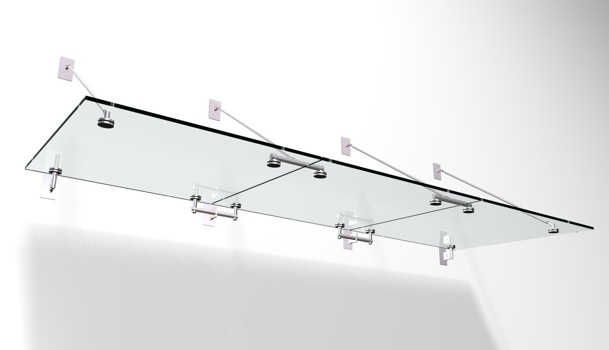

Стеклянные козырьки превосходно сочетаются с любыми дверными группами, имеют стильный вид, хорошо выполняют свою прямую функцию по защите входа в здание от осадков. Их используют в наружном оформлении частных коттеджей, торговых центров, офисных и муниципальных зданий. За счет нейтрального дизайна, навесы можно использовать в домах, построенных в современных и классических традициях архитектуры.

## Технология производства и монтажа

Для создания конструкции производитель – фирма «Архи Гласс», использует прочное стекло и фирменную фурнитуру. Прибегая к ее услугам можно получить устойчивый к повреждениям козырек, который соответствует жестким стандартам качества, отличается достаточной жесткостью, надежностью и долговечностью. Изделие фиксируется по месту одним из следующих способов:

**Ванты**  
Цельностеклянные изогнутые конструкции могут иметь немалый вес. Их монтируют на специальных планках-консолях из нержавеющего алюминия, а к стене прикрепляют при помощи вантов.

**Балки и тяги**  
На тягах и балках установку производят в беседках, шатрах, на террасах. Вариант предполагает двойной монтаж с размещение крепежных элементов в полу и в стене.

**Опоры**  
Для поддержки могут использоваться и опоры, забетонированные в пол у входа. Они смотрятся презентабельно, лучше всего подходят для зданий с большой площадью и выразительным экстерьером.

## Обзор преимуществ стеклянных козырьков

**Существует ряд преимуществ, которые стоит принять на заметку владельцам недвижимости:**

Простота ухода  
Стекло не требует тщательного ухода. Его нужно лишь периодически очищать от загрязнений, путем визуального осмотра проверять целостность полотна. Поскольку фурнитура, применяемая для монтажа, не подвергается воздействию коррозии, ее не нужно окрашивать и обрабатывать специальными защитными составами.

Оптимальная форма  
Форма козырька проектируется таким образом, чтобы на поверхности не скапливалась вода, а отвод ливневых стоков был максимально эффективным. Он доступен к заказу в таких вариантах исполнения:

- в виде арки и волны;
- одно- и двускатный;
- куполообразный;
- прямой и пр.

Совместимость с дополнительными аксессуарами  
Есть возможность оснастить навес приятной светодиодной подсветкой, встроенной системой электрического подогрева, которая препятствует обледенению и скоплению снега в период зимних вьюг. К прочим плюсам относят доступную стоимость изготовления, быстрый процесс установки, широкую сферу применения (крытые рынки, рестораны, зимние сады и т.п.).

## Специфика выбора конструкции

Прежде чем утвердить проект, представленный на рассмотрение инженерами компании-производителя, стоит тщательно перепроверить основные детали. В их числе:

- используемый тип стекла (триплекс, закаленный материал);
- наличие пленочного покрытия для тонировки и затенения;
- габариты, вес, специфика креплений.

Модная и эффектная светопрозрачная конструкция станет оригинальным и изящным решением оформления фасада. Навес красиво подчеркнет дверной проем, станет стильным дополнением арки, крыльца или террасы.
