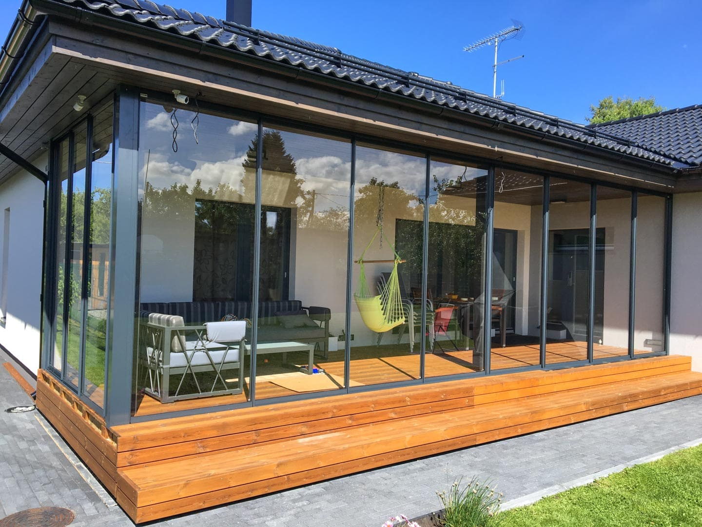
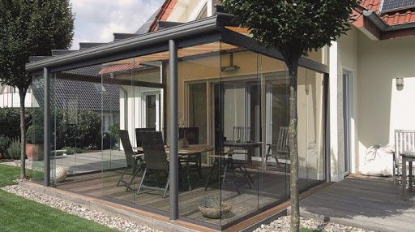

В частном доме обычно делаются неотапливаемые пристройки для отдыха в летнее время – терраса или веранда. Остекление террас и веранд позволяет создать внутри этих построек более комфортный микроклимат, обеспечивает защиту от осадков и ветра, расширяет возможности их использования. Также на даче, приусадебном участке нередко строят беседки, обычно с открытыми проемами. Но в последнее время довольно популярным решением становится остекление беседок.

## Остекление террас

Остекление террас не является обязательным и часто осуществляется через некоторое время после завершения их строительства. Классическая терраса – это открытая пристройка с отдельным фундаментом или площадка неподалеку от дома, иногда обустроенная на плоской кровле дома. Обычно такая площадка накрыта крышей, которая опирается на столбики, но у нее нет ни собственных стен, ни окон, ни дверей. Остекление позволяет превратить террасу в закрытую постройку (пристройку). На застекленной террасе проще поддерживать чистоту, полы и мебель защищены от осадков, сидеть здесь можно в прохладную, ветреную погоду.

На террасах чаще всего осуществляется:

- панорамное остекление, поскольку они открыты полностью, от пола до крыши. При наличии сплошного парапета остекление может монтироваться на него, если ограждение решетчатое, остекление монтируют на пол за ним;
- холодное остекление, поскольку они не отапливаются, используются только в теплый сезон. Исключение составляют капитальные сооружения на основательном фундаменте, с утепленной и защищенной от протечек крышей, массивными столбиками, на которые она опирается;
- раздвижное остекление, которое позволяет в зависимости от погоды делать террасу то открытой для свежего воздуха, то закрытой для ветра и дождя. Но возможны и другие варианты – складные панорамные окна, комбинация глухих и распашных или откидных створок;
- сплошное остекление по всему периметру (для террасы-пристройки – за исключением той стороны, что примыкает к дому). Частичное остекление возможно в случае, если у террасы есть глухая стена (стены) или опоры для крыши достаточно широкие и могут играть роль простенков между окнами.

Еще один интересный вариант – остекление не только стен, но и крыши, такую террасу можно использовать для солнечных ванн, но ее желательно оснастить тканевой маркизой. Технология остекления зависит от выбранного способа. При безрамном на пол и к каркасу крыши монтируются направляющие, в них устанавливаются закаленные стекла. При остеклении профильными системами сначала собирается каркас, в который устанавливаются стеклопакеты в ПВХ-профиле или стекла в алюминиевом профиле.

## Остекление веранд

Веранда – пристройка к дому на общем с ним фундаменте, обычно застекленная, поэтому остекление веранд почти всегда осуществляется на этапе строительства. В зависимости от наличия-отсутствия глухих стен оно может быть сплошным или частичным. Веранда может представлять собой постройку со стенами, в которых сделаны оконные проемы, в этом случае ее остекление выполняется так же, как остекление дома в целом. Если невысокая стена типа парапета возведена только в нижней части пристройки, технология остекления та же, что для балконов. Возможно также панорамное остекление веранд, если пространство от пола до крыши полностью открытое.

На верандах обычно выполняют глухое остекление, часто с многочисленными импостами, только 1-2 створки делают распашными. Цена такого остекления значительно ниже, чем раздвижного. Стеклами с алюминиевым профилем остекляют преимущественно неутепленные веранды. Поскольку эти пристройки в загородном доме обычно используются круглый год, для них предпочтительней теплое остекление стеклопакетами в деревянном или металлопластиковом профиле. Если веранда является частью деревянного дома, наиболее органично будет выглядеть остекление с деревянными рамами, ПВХ профиль хорошо сочетается с виниловым сайдингом. Теплый вариант остекления требует хорошей теплоизоляции всех ограждающих конструкций.

## Остекление беседок

В Тольятти остекленные беседки можно увидеть прямо в городе, а также на загородных участках. Традиционно беседки является открытым сооружением для отдыха на свежем воздухе, поэтому их стационарное остекление выполняют редко. Чаще используют бюджетные заменители стекла, так называемые мягкие окна – плоские рамки из прочного полимерного полотна с заполнением плотной поливинилхлоридной или полиуретановой пленкой. Еще один недорогой вариант – крепление к каркасу беседки листов сотового поликарбоната.

Полноценное остекление беседок чаще всего холодное, поскольку это постройки для сезонного использования. Осуществляется оно с применением систем на основе алюминиевого профиля, может быть глухим, с распашными оконными и дверными створками, а также раздвижным. Очень эффектно выглядит панорамное остекление, особенно безрамное, оно визуально не утяжеляет изящную постройку. Стеклопакеты для остекления беседок применяют редко, только если они используются круглый год.

В принципе остекление малых архитектурных форм осуществляется по той же технологии, что и домов. Но несущие конструкции беседок зачастую не рассчитаны на значительную нагрузку, поэтому остекление должно быть легким. И еще один нюанс – беседки часто строятся с арочными, стрельчатыми проемами, стоимость такого остекления значительно выше. Так что если беседку изначально планируется остеклять, лучше выбрать более простую форму.

## Заказать остекление террас, веранд и беседок в тольятти

Остекление пристроек к частным домам и беседок – довольно сложная задача. Поскольку беседки, террасы, веранды отличаются большим разнообразием, для каждого конкретного случая разрабатывается индивидуальный проект. Мы:

- подберем оптимальный вариант остекления с учетом конструктивных особенностей постройки и целей, для которых ее планируется использовать;
- выполним расчет стоимости и согласуем ее с заказчиком;
- изготовим все элементы системы остекления;
- осуществим квалифицированный монтаж.

Значительный опыт деятельности в сфере производства светопрозрачных конструкций, использование современного оборудования – залог высокого качества продукции ДизайнСтекло. А цена остекления максимально доступная, ведь мы – компания-производитель.
